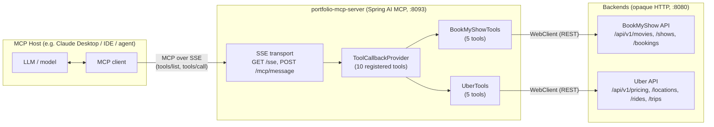
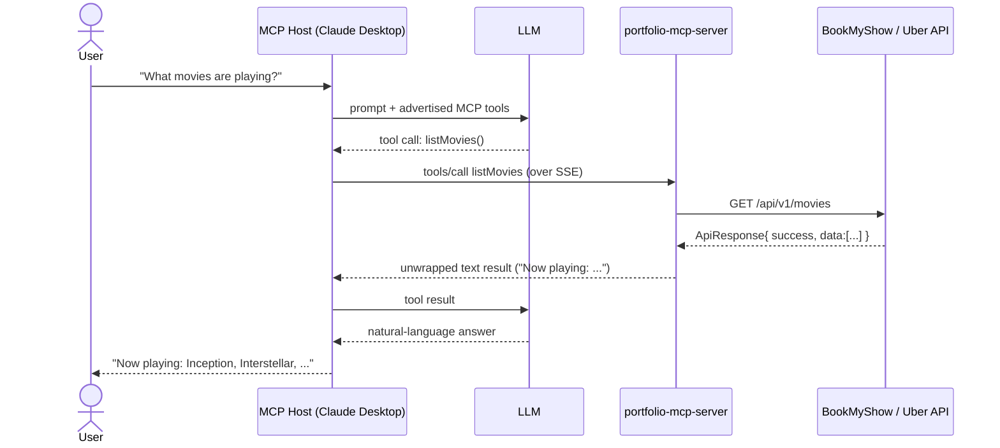

# Diagrams — portfolio-mcp-server

Visual companion to the [README](./README.md). Two Mermaid diagrams: the MCP architecture, and a
single tool call end-to-end.

## 1. MCP architecture

How an MCP host (e.g. Claude Desktop) reaches the BookMyShow + Uber backends through this server.
The host owns the model; **this** server owns the tools; the backends own the data.

## 2. A single tool call, end-to-end

The host asks the model, the model decides to call a tool over MCP, this server invokes the tool
which calls the backend, and the result flows back so the model can answer.

